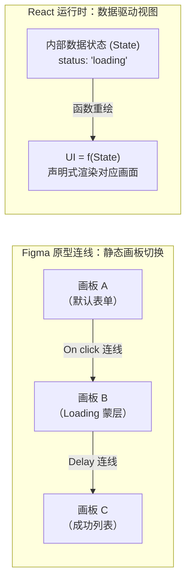
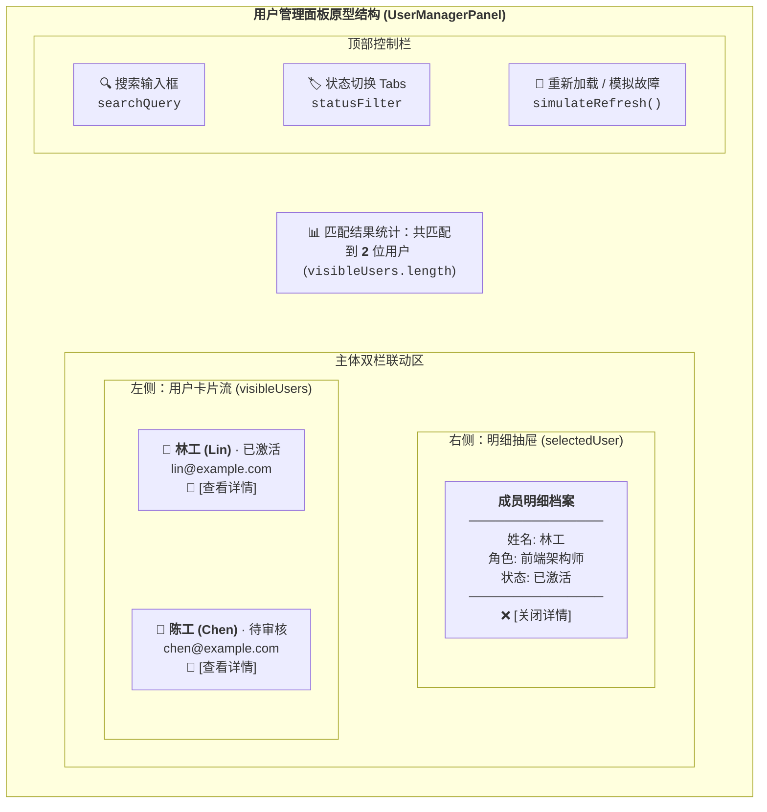
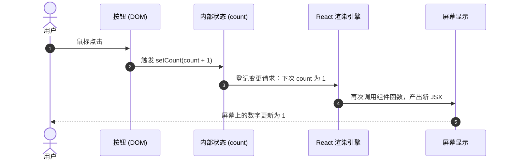
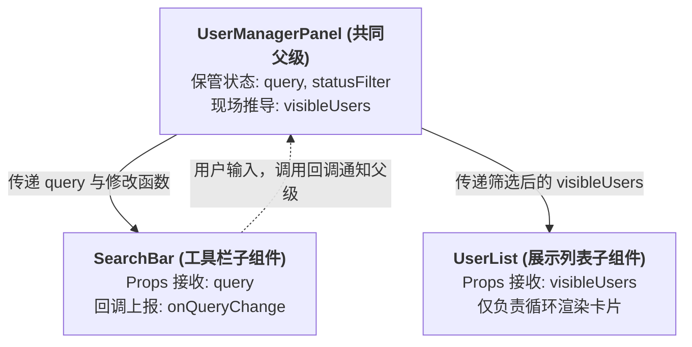
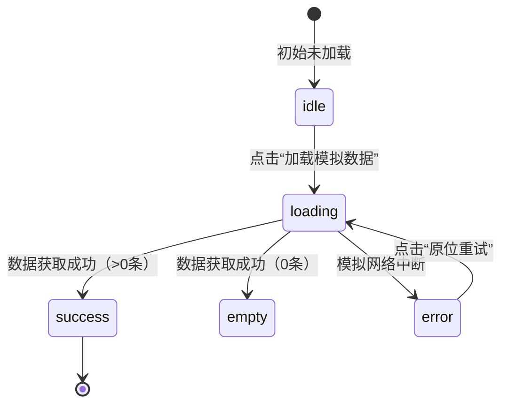

# 让组件动起来：UI 设计师的 React 须知

当我们把一个按钮在静止、悬停、按压、Loading 以及禁用等各状态下的样式和类名都规整好后，很多同学看着画出来的 Spinner 在画板上转得挺漂亮，可真一把代码丢进浏览器跑起来，立马就会冒出新的困惑：

这个按钮确实顶着一张“正在加载”的脸，但用户点下去的那一下，到底谁负责把它切进 Loading？数据拿回来后，又是谁通知它变回默认态？万一接口报错了，哪段逻辑负责把红色报错盖上去？

这篇分享将解答你的疑惑：**带大家理清用户操作到底是怎么改变数据、而 React 又是怎么根据数据更新画面的**。通过结合底层的状态流动机制来学习语法，提高大家看懂交互代码的效率、加深对数据流动的理解。

把这些搞明白了，面对 AI 写出来的代码，你就不只是盯着 CSS 类名挑刺，而是能一眼看出：“搜索框的值变了，下面的列表怎么根本没过滤？而且能算出来的结果为什么又建了个状态？”

---

## 从原型连线到状态驱动

很多设计师在刚接触前端框架时，最难转过弯的是**交互驱动方式的差异**。

在 Figma 里做交互原型，我们的思维是“连线切画板”：给按钮加一个 `On click` 交互，箭头拖到右边那个带 Loading 动画的画板，或者弹出一个早已摆好的浮层。本质上，Figma 的交互是**基于画板状态的硬切换**。



而浏览器里的真实应用完全是另一套物理规则。React 官方文档对组件有一句最核心的定调：

> **UI 是关于状态的纯函数映射（UI = f(state)）。**

用大白话来说就是：**界面只是某一瞬间数据的倒影。**

你不需要在点击按钮时手写代码去命令浏览器：“把按钮的背景色改成灰色、把文字藏起来、再把加载图标插入进来”；你只需要在内存里把一个变量改成“正在加载中”，React 自然会拿着这套新数据，重新计算出这个按钮在这一瞬间该长什么样。我们要做的，就是**理清组件背后的数据流向，把这些静态模块真正组合成能跑、能交互的软件**。

---

## 经典案例：用户管理面板

为了不让大家迷失在繁杂的 API 字典里，我们今天只围绕一个贯穿始终的轻量实战案例：**一个可搜索、可筛选的用户管理面板**。



这个面板看着简单，但前端最基础的几条交互链路都在里面：
1. **输入与筛选**：搜索框敲字、下拉选择器切状态；
2. **列表展示**：根据多条结构化数据，平铺成一组卡片；
3. **主从交互**：点击某张卡片上的“查看详情”，右侧弹出对应的详情浮层；
4. **生命周期演练**：首次进入需要点击“加载用户”，中途有 Loading 骨架屏，无数据时有友好空状态，模拟失败时能原位重试。

### 读懂交互代码的 4 个切入点

在看任何一段由 AI 生成的交互代码时，只要能顺着回答出这 4 个问题，心里基本就有数了：
1. **这块界面的内容，是外头传进来的参数，还是组件自己的私有记忆？**
2. **用户点了或者敲了之后，到底是内存里的哪一个数值变了？**
3. **当前屏幕上的哪些区域，是由这个数值直接决定的？**
4. **当两个独立的子模块需要步调一致时，这个数值应该放在哪儿保管？**

> 本篇代码采用简单的 React + TypeScript 书写。我们只用它来模拟属性名，不展开讲复杂的类型体操；所有样式直接采用规范的 Tailwind 类名。

---

## Props 参数传递与组件复用

在 Figma 里，当我们需要做 10 张用户卡片时，我们会把一个名为 `UserCard` 的组件实例化 10 次，然后在右侧面板里把名字、头像和标签逐一替换。

在 React 里，这个过程叫**传递组件参数（Props）**。

### 组件的函数本质与入参

抛开框架外壳，React 组件在底层就是一个普通的 JavaScript 函数。如果把组件比作一台榨汁机，Props 就是你丢进去的水果：丢苹果出来苹果汁，丢橙子出来橙子汁，榨汁机本身的结构不需要焊死 10 份。

```tsx{2-7,9,29}
// UserCard.tsx：只负责呈现单张用户卡片
interface UserCardProps {
  name: string
  email: string
  status: "active" | "pending"
  onViewDetails: () => void // 接收一个点击动作
}

export function UserCard({ name, email, status, onViewDetails }: UserCardProps) {
  return (
    <div className="p-4 rounded-xl border border-border bg-surface flex items-center justify-between gap-4">
      <div>
        <div className="flex items-center gap-2">
          <h4 className="font-semibold text-text-primary">{name}</h4>
          <span
            className={`text-xs px-2 py-0.5 rounded-full ${
              status === "active"
                ? "bg-emerald-50 text-emerald-700"
                : "bg-amber-50 text-amber-700"
            }`}
          >
            {status === "active" ? "已激活" : "待审核"}
          </span>
        </div>
        <p className="text-sm text-text-muted mt-1">{email}</p>
      </div>

      <button
        onClick={onViewDetails}
        className="px-3 py-1.5 text-sm rounded-lg border border-border hover:bg-surface-subtle transition-colors shrink-0"
      >
        查看详情
      </button>
    </div>
  )
}
```

注意看这段代码里的条核心原则：

- **单向数据流（Props 只读）**：子组件绝对不能自己修改传进来的 Props。`UserCard` 内部不能写 `name = "张三"`。这就好比快递员只管把包裹送到你家，不能擅自拆开把里面的东西换掉。
- **动作也是参数**：看到 `onViewDetails` 了吗？它不是一个普通的字符串，而是一个**函数参数**。子组件不需要知道“点开之后弹窗究竟怎么画”，它只需要在按钮被按压时喊一声：“报告！我身上的查看详情被点了！”具体的处理逻辑由外层父组件处理。

---

## 内部状态 useState 与快照渲染

很多朋友刚写交互时，经常会犯这样一个错误：

```tsx{3,6,10}
// ❌ 错误示范：自以为改了变量就能让界面重新渲染
export function Counter() {
  let count = 0

  function handleClick() {
    count = count + 1
    console.log("当前数量：", count) // 控制台里确实打印了 1, 2, 3...
  }

  return <button onClick={handleClick}>点击次数：{count}</button> // 页面上的数字死活是 0！
}
```

为什么控制台里的数字在涨，画面却纹丝不动？

因为普通局部变量 `let count` 只是函数内部执行时的一个临时数据，它有两个根本问题：
1. **React 感觉不到它变了**：修改它不会触发重新渲染。
2. **存不住**：每次组件重新渲染、函数再次执行，`let count` 都会被重新赋初值 `0`。

### useState 与渲染调度

要想让变量的变动引起屏幕重绘，我们必须使用 React 提供的专用记忆工具：`useState`。

```tsx{6,9}
import { useState } from "react"

export function Counter() {
  // useState 返回一个数组：[当前快照值, 通知更新的触发器]
  const [count, setCount] = useState(0)

  function handleClick() {
    setCount(count + 1) // 正确做法：呼叫更新触发器
  }

  return <button onClick={handleClick}>点击次数：{count}</button>
}
```



要理解这个渲染过程，记住三件事就行：
- `useState(0)` 里的 `0` 只是**初始值**，只在组件第一次登场（Mount）时生效一次；
- `setCount` 不是立刻把原处的变量擦掉改写，而是**向 React 预约下一次重新渲染**；
- React 重新调用组件函数时，拿出来的是当次渲染的一份**状态快照（State as Snapshot）**。[^react-state-snapshot]

### 事件回调绑定与传参时机

初学者在给按钮绑定点击事件时，有 90% 的概率踩过这个坑：

```tsx
// ❌ 错误示范：一进页面弹窗直接自动弹开，控制台无限报错死循环
<button onClick={openDetails()}>查看详情</button> // [!code --]

// ✅ 正确示范 A：直接传递函数名字作为回调引用
<button onClick={openDetails}>查看详情</button> // [!code ++]

// ✅ 正确示范 B：需要带参数时，用一个内联剪头函数包一层
<button onClick={() => setSelectedUser(user)}>查看详情</button>
```

为什么加了个括号区别这么大？
- `onClick={openDetails()}`：括号代表**立刻执行**。这意味着页面在刚准备把按钮画出来时，就强行把 `openDetails()` 给执行了！如果这个函数里面恰好又调用了 `setIsOpen(true)`，就会导致：渲染 -> 执行更新 -> 触发重新渲染 -> 再次执行更新……浏览器直接当场内存溢出报崩。
- `onClick={openDetails}` 或 `onClick={() => ...}`：传递的是**一段尚未执行的代码配方**。意思是：“我先把这段逻辑放在这儿，等用户真正用手指戳中按钮时，你再替我执行”。

---

## 搜索与列表联动

掌握了单点状态，我们来看最关键的联动场景：用户在搜索框里输入文字，下方的列表实时过滤。

### 受控输入框与数据闭环

在原生 HTML 里，输入框敲什么字是由浏览器 DOM 原生维护的。但如果 React 不知道输入框里装的是什么，就根本没办法拿这串文字去过滤列表。

因此在现代前端开发中，我们必须把它改造为**受控输入（Controlled Input）**：

```tsx{8-9,15}
export function SearchBar() {
  const [query, setQuery] = useState("")

  return (
    <div className="relative">
      <input
        type="text"
        value={query} // 1. 界面里显示的字，必须老老实实听 state 的
        onChange={(e) => setQuery(e.target.value)} // 2. 键盘敲击触发时，立刻把新输入写回 state
        placeholder="搜索用户姓名..."
        className="w-full px-4 py-2 border border-border rounded-lg bg-surface text-text-primary focus:outline-none focus:border-border-focused"
      />
      {query && (
        <button
          onClick={() => setQuery("")}
          className="absolute right-3 top-2.5 text-xs text-text-muted hover:text-text-primary"
        >
          清空
        </button>
      )}
    </div>
  )
}
```

这串操作就连成了一个完整的数据流动通道：
键盘按压 -> 触发 `onChange` -> 提取输入字符 `e.target.value` -> 呼叫 `setQuery` -> React 重新渲染 -> 输入框把最新的 `query` 吐在屏幕上。

### 派生数据与计算去重

React 官方关于状态结构的建议是：只保留必要的源头状态，把能由它们计算出的值作为派生数据。[^react-state-structure]

这是初学甚至写过一段时间前端的人最容易踩的坑：**把能算出来的值也存成了状态**。

很多人第一反应是这样定义状态的：
```tsx{4-5}
// ❌ 冗余的状态设计：把能算出来的东西也存成了独立状态
const [users, setUsers] = useState(initialUsers) // 原始用户
const [query, setQuery] = useState("") // 搜索词
const [filteredUsers, setFilteredUsers] = useState(initialUsers) // 筛选后的列表（冗余！）
const [matchCount, setMatchCount] = useState(initialUsers.length) // 匹配数量（冗余！）
```

只要这样写，后面维护很容易出 Bug：
每次用户敲击键盘，你不仅要更新 `query`，还必须同步调用 `setFilteredUsers`，同时还得记得调用 `setMatchCount`。稍有漏写，就会出现“输入框搜张三，列表过滤了，但上面依然显示‘共匹配到 5 条结果’”这种数据脱节的情况。

更常见的一个反例是：有的同学为了省事，在搜索时直接写 `setUsers(users.filter(...))`——把筛选结果直接覆盖了原始数据。结果就是用户打了一个字，原始列表瞬间丢失，等把搜索词退格删空时，页面再也变不回完整的初始数据了。

更稳妥的做法是：**只存源头数据，其余全部在渲染时现场计算（Derived Data，派生数据）**。

```tsx{7-11,14}
// ✅ 干净的标准设计：零冗余状态
const [users, setUsers] = useState(initialUsers) // 唯一源头：完整的原始用户列表
const [query, setQuery] = useState("") // 交互条件 A：搜索关键词
const [statusFilter, setStatusFilter] = useState<"all" | "active" | "pending">("all") // 交互条件 B

// 派生数据：在每次组件渲染时直接现场算出来！
const visibleUsers = users.filter((user) => {
  const matchesQuery = user.name.toLowerCase().includes(query.toLowerCase())
  const matchesStatus = statusFilter === "all" || user.status === statusFilter
  return matchesQuery && matchesStatus
})

// 匹配数量根本不需要存状态，直接读取数组长度！
const matchCount = visibleUsers.length
```

打个生活比方：
你记账时，只需要老老实实记录每件商品的单价和数量（源头事实），总金额永远是算出来的。没有人会每买一样东西，都在小本子上专门开辟一页去手动抄写一遍“此时此刻的总价”——因为多记一次，就多了一次抄错账的风险。

在原型体量下，百十条数据的内存过滤只耗费零点几毫秒，直接在渲染函数里现场计算，代码既干净又绝无状态不同步的可能。

### 状态提升与组件通信

当多个组件需要共享同一份状态时，可以把状态提升到它们最近的共同父组件。[^react-lifting-state]

在实际项目中，我们往往习惯把搜索栏拆成 `SearchBar.tsx`，把列表拆成 `UserList.tsx`。

这时候问题来了：`query` 状态如果放在 `SearchBar` 内部，下方的 `UserList` 根本拿不到它；如果放在 `UserList` 里，上面的搜索框又没办法修改它。

处理这种情况的通用做法叫**状态提升（Lifting State Up）**：



把共享的状态抽离，放到它们**最近的共同父组件**中去保管。父组件像个大管家，把数据顺着 Props 往下发给列表，把修改数据的遥控器（回调函数）发给搜索栏。

在设计原型阶段，**完全不需要急着引入 Redux、Zustand 这类全局状态管理工具**。利用组件树就近提升状态，已经足够应付 95% 的业务交互场景；盲目上状态库只会徒增一层难以追踪的黑盒抽象。

---

## 多分支形态与条件渲染

在画静态设计稿时，我们要给产品经理展示“有数据”、“无匹配结果”、“加载中”三种形态，往往得在画布上并排复制出 3 张完整的画板。

但在代码世界里，**结构只写一套，画面分支全由条件控制**。

### 三元表达式与短路求值

在 JSX 语法中，切换界面的核心方式有两种：

**方式 1：三元表达式（二选一互斥切换）**
```tsx
{visibleUsers.length > 0 ? (
  <div className="grid gap-3">
    {visibleUsers.map((user) => (
      <UserCard key={user.id} user={user} onViewDetails={() => setSelectedUser(user)} />
    ))}
  </div>
) : (
  <div className="p-8 text-center border border-dashed rounded-xl bg-surface-subtle">
    <p className="text-text-muted">没有找到符合条件的用户</p>
    <button
      onClick={() => { setQuery(""); setStatusFilter("all"); }}
      className="mt-2 text-sm text-color-brand hover:underline"
    >
      清空筛选条件
    </button>
  </div>
)}
```

**方式 2：短路求值 `&&`（有就显示，没有就彻底不渲染）**
```tsx
{/* 只有当选中了用户时，右侧抽屉浮层才挂载出来 */}
{selectedUser && (
  <UserDetailDrawer
    user={selectedUser}
    onClose={() => setSelectedUser(null)} // 点关闭时把选中值置空即可
  />
)}
```

### 列表渲染与稳定 Key

列表项的 `key` 应该稳定地对应数据实体，而不是随着过滤或重排变化的数组下标。[^react-list-keys]

当我们需要把一个数组批量倒模成一组卡片时，使用原生数组的 `.map()` 方法：

```tsx{3}
{visibleUsers.map((user) => (
  <UserCard
    key={user.id} // ⚠️ 极其关键：必须使用数据自身唯一的稳定 ID！
    name={user.name}
    email={user.email}
    status={user.status}
    onViewDetails={() => setSelectedUser(user)}
  />
))}
```

**为什么严禁偷懒写 `key={index}`？**

很多同学在让 AI 写列表时，经常会看到 `map((item, index) => <div key={index}>)` 这种代码。如果列表永远是一成不变的死数据，用数组下标 `index` 凑合确实看不出毛病。

但在当前这个有“搜索过滤”和“排序删除”的列表里，用 `index` 会引发奇怪的错位问题：
假设当前第 0 个是“林工”，第 1 个是“陈工”；当你在搜索框搜“陈”时，原本排在第 1 位的陈工变成了筛选结果里的第 0 位。如果使用 `index` 做 Key，React 会误以为：“哦，第 0 项还是那个第 0 项，只是文字换了”，导致卡片内部未受控的勾选框、临时输入框甚至微动效全部错位张冠李戴。

记住一条底线：**任何具有过滤、重排、增删特性的列表，Key 必须取业务实体自身的唯一 ID（如 `user.id`）**。

---

## 异步状态与流程闭环

一个合格的界面往往需要具备骨架屏（Skeleton）、空状态（Empty）与异常兜底（Error）。

现在我们用真实的状态机把它们全部串起来：



### 互斥状态枚举与联合类型

千万不要这样设计请求状态：
```tsx
// ❌ 极度脆弱的状态设计
const [isLoading, setIsLoading] = useState(false)
const [isSuccess, setIsSuccess] = useState(false)
const [isError, setIsError] = useState(false)
```

因为在逻辑上，这三个状态完全是**互斥**的。如果代码写得不够缜密，很容易意外制造出 `isLoading === true` 同时 `isError === true` 的荒诞局面，让屏幕上同时出现转圈圈和报错红字。

更干净的做法是用**联合类型**把状态枚举出来：

```tsx{1,4,10-11,15-19,25,40,44} :height=32rem
type RequestStatus = "idle" | "loading" | "success" | "error"

export function UserManager() {
  const [status, setStatus] = useState<RequestStatus>("idle")
  const [errorMessage, setErrorMessage] = useState("")
  const [users, setUsers] = useState<User[]>([])

  // 模拟一个带网络延迟的异步数据拉取
  function fetchMockUsers(shouldFail = false) {
    setStatus("loading")
    setErrorMessage("")

    setTimeout(() => {
      if (shouldFail) {
        setStatus("error")
        setErrorMessage("模拟网络连接超时，无法拉取人员名单。")
      } else {
        setUsers(MOCK_USERS_DATA)
        setStatus("success")
      }
    }, 800) // 延迟 800ms 展现骨架屏
  }

  // 渲染分流
  if (status === "idle") {
    return (
      <div className="p-12 text-center border rounded-xl bg-surface">
        <h3 className="font-semibold text-text-primary">人员管理工作台</h3>
        <p className="text-sm text-text-muted mt-1">尚未装载组织架构成员数据</p>
        <button
          onClick={() => fetchMockUsers(false)}
          className="mt-4 px-4 py-2 bg-color-brand text-white rounded-lg hover:bg-color-brand-hover"
        >
          加载模拟数据
        </button>
      </div>
    )
  }

  if (status === "loading") {
    return <UserListSkeleton /> // 展示闪烁骨架屏
  }

  if (status === "error") {
    return (
      <div className="p-8 border border-red-200 bg-red-50 text-center rounded-xl">
        <p className="text-sm text-red-600 font-medium">{errorMessage}</p>
        <button
          onClick={() => fetchMockUsers(false)} // 原位重试
          className="mt-3 px-3 py-1.5 text-xs bg-red-600 text-white rounded-md"
        >
          立即重试
        </button>
      </div>
    )
  }

  // 走入正常数据面板
  return <UserMainPanel users={users} onReload={() => fetchMockUsers(false)} />
}
```

通过这一层收敛，状态在任何瞬间都只有唯一的合法走向，逻辑干净又互斥，根本不可能再出现状态互相打架的低级 Bug。

---

## 完整交互面板组装

到这里，几个核心概念就串起来了。我们把它们合在一起，写成一个完整的单文件组件：

### 完整实现代码

```tsx :collapsed-lines=12
// UserManagerPanel.tsx：状态完备的轻量交互面板
import React, { useState } from "react"
import { Search, RotateCcw, X, AlertCircle } from "lucide-react"

interface User {
  id: string
  name: string
  email: string
  role: string
  status: "active" | "pending"
}

const INITIAL_DATA: User[] = [
  { id: "u-1", name: "林工 (Lin)", email: "lin@example.com", role: "前端架构师", status: "active" },
  { id: "u-2", name: "陈工 (Chen)", email: "chen@example.com", role: "交互设计师", status: "pending" },
  { id: "u-3", name: "赵工 (Zhao)", email: "zhao@example.com", role: "全栈工程师", status: "active" },
  { id: "u-4", name: "钱工 (Qian)", email: "qian@example.com", role: "产品经理", status: "pending" },
]

export function UserManagerPanel() {
  // 1. 基础源头数据与加载状态
  const [loadState, setLoadState] = useState<"idle" | "loading" | "ready" | "error">("ready")
  const [users, setUsers] = useState<User[]>(INITIAL_DATA)

  // 2. 交互查询条件（单一事实源）
  const [searchQuery, setSearchQuery] = useState("")
  const [statusFilter, setStatusFilter] = useState<"all" | "active" | "pending">("all")

  // 3. 当前被聚焦检视的实体
  const [selectedUser, setSelectedUser] = useState<User | null>(null)

  // 4. 纯函数即时派生出过滤结果
  const visibleUsers = users.filter((u) => {
    const matchesName = u.name.toLowerCase().includes(searchQuery.toLowerCase())
    const matchesStatus = statusFilter === "all" || u.status === statusFilter
    return matchesName && matchesStatus
  })

  // 模拟重新拉取
  function simulateRefresh(shouldFail = false) {
    setLoadState("loading")
    setSelectedUser(null) // 刷新时关掉可能展开的详情
    setTimeout(() => {
      if (shouldFail) {
        setLoadState("error")
      } else {
        setUsers(INITIAL_DATA)
        setLoadState("ready")
      }
    }, 600)
  }

  return (
    <div className="w-full max-w-4xl mx-auto p-6 bg-surface rounded-2xl border border-border shadow-sm font-sans">
      {/* 头部控制栏 */}
      <div className="flex flex-col md:flex-row items-stretch md:items-center justify-between gap-4 pb-6 border-b border-border">
        <div>
          <h2 className="text-xl font-bold text-text-primary">团队成员管理</h2>
          <p className="text-sm text-text-muted mt-0.5">即时过滤、状态下钻与响应式交互演练</p>
        </div>

        <div className="flex items-center gap-2">
          <button
            onClick={() => simulateRefresh(false)}
            disabled={loadState === "loading"}
            className="flex items-center gap-1.5 px-3 py-1.5 text-xs font-medium rounded-lg border border-border hover:bg-surface-subtle transition-colors disabled:opacity-50"
          >
            <RotateCcw className={`w-3.5 h-3.5 ${loadState === "loading" ? "animate-spin" : ""}`} />
            重新加载
          </button>
          <button
            onClick={() => simulateRefresh(true)}
            className="px-3 py-1.5 text-xs font-medium rounded-lg border border-red-200 text-red-600 hover:bg-red-50 transition-colors"
          >
            模拟故障
          </button>
        </div>
      </div>

      {/* 错误提示态 */}
      {loadState === "error" && (
        <div className="my-6 p-4 rounded-xl border border-red-200 bg-red-50/50 flex items-center justify-between">
          <div className="flex items-center gap-3 text-red-700 text-sm">
            <AlertCircle className="w-4 h-4 shrink-0" />
            <span>模拟服务端接口响应 500 异常，请检查网络配置后重试。</span>
          </div>
          <button
            onClick={() => simulateRefresh(false)}
            className="px-3 py-1 bg-red-600 text-white text-xs font-medium rounded-md hover:bg-red-700"
          >
            重试
          </button>
        </div>
      )}

      {/* 过滤筛选工具区 */}
      {loadState !== "error" && (
        <div className="py-4 flex flex-col sm:flex-row items-center justify-between gap-3">
          <div className="relative w-full sm:w-72">
            <Search className="w-4 h-4 absolute left-3 top-2.5 text-text-muted" />
            <input
              type="text"
              value={searchQuery}
              onChange={(e) => setSearchQuery(e.target.value)}
              placeholder="搜索姓名..."
              className="w-full pl-9 pr-4 py-1.5 text-sm rounded-lg border border-border bg-surface focus:outline-none focus:border-color-brand"
            />
          </div>

          <div className="flex items-center justify-between w-full sm:w-auto gap-4">
            <div className="flex items-center gap-1 bg-surface-subtle p-1 rounded-lg border border-border">
              {(["all", "active", "pending"] as const).map((tab) => (
                <button
                  key={tab}
                  onClick={() => setStatusFilter(tab)}
                  className={`px-3 py-1 text-xs rounded-md font-medium transition-all ${
                    statusFilter === tab
                      ? "bg-surface text-text-primary shadow-xs"
                      : "text-text-muted hover:text-text-primary"
                  }`}
                >
                  {tab === "all" ? "全部" : tab === "active" ? "已激活" : "待审核"}
                </button>
              ))}
            </div>

            <span className="text-xs text-text-muted shrink-0">
              匹配到 <strong className="text-text-primary font-semibold">{visibleUsers.length}</strong> 位
            </span>
          </div>
        </div>
      )}

      {/* 主体呈现区：双栏弹性并排 */}
      {loadState === "ready" && (
        <div className="grid grid-cols-1 md:grid-cols-3 gap-6 pt-2">
          {/* 左侧两栏：列表区 */}
          <div className="md:col-span-2 space-y-3">
            {visibleUsers.length > 0 ? (
              visibleUsers.map((user) => (
                <div
                  key={user.id}
                  className={`p-4 rounded-xl border transition-all flex items-center justify-between gap-4 ${
                    selectedUser?.id === user.id
                      ? "border-color-brand bg-blue-50/20 shadow-xs"
                      : "border-border bg-surface hover:border-text-muted"
                  }`}
                >
                  <div>
                    <div className="flex items-center gap-2">
                      <span className="font-semibold text-sm text-text-primary">{user.name}</span>
                      <span
                        className={`text-[10px] px-2 py-0.5 rounded-full font-medium ${
                          user.status === "active"
                            ? "bg-emerald-50 text-emerald-700 border border-emerald-200"
                            : "bg-amber-50 text-amber-700 border border-amber-200"
                        }`}
                      >
                        {user.status === "active" ? "已激活" : "待审核"}
                      </span>
                    </div>
                    <p className="text-xs text-text-muted mt-1">{user.role} · {user.email}</p>
                  </div>

                  <button
                    onClick={() => setSelectedUser(user)}
                    className="px-3 py-1.5 text-xs font-medium rounded-lg border border-border hover:bg-surface-subtle transition-colors shrink-0"
                  >
                    查看详情
                  </button>
                </div>
              ))
            ) : (
              <div className="py-12 text-center border border-dashed border-border rounded-xl">
                <p className="text-sm text-text-muted">未找到任何符合匹配条件的人员</p>
                <button
                  onClick={() => { setSearchQuery(""); setStatusFilter("all"); }}
                  className="mt-2 text-xs text-color-brand hover:underline font-medium"
                >
                  重置筛选条件
                </button>
              </div>
            )}
          </div>

          {/* 右侧一栏：详情信息抽屉卡片 */}
          <div className="md:col-span-1">
            {selectedUser ? (
              <div className="p-5 rounded-xl border border-border bg-surface-subtle relative animate-in fade-in duration-200">
                <button
                  onClick={() => setSelectedUser(null)}
                  className="absolute top-4 right-4 text-text-muted hover:text-text-primary"
                  aria-label="关闭详情"
                >
                  <X className="w-4 h-4" />
                </button>

                <h3 className="text-sm font-bold text-text-primary uppercase tracking-wider mb-4">成员明细档案</h3>
                
                <div className="space-y-3 text-xs">
                  <div>
                    <span className="text-text-muted block">系统分配唯一编号</span>
                    <span className="font-mono text-text-primary mt-0.5 block">{selectedUser.id}</span>
                  </div>
                  <div>
                    <span className="text-text-muted block">真实姓名</span>
                    <span className="text-text-primary font-medium mt-0.5 block">{selectedUser.name}</span>
                  </div>
                  <div>
                    <span className="text-text-muted block">岗位角色</span>
                    <span className="text-text-primary font-medium mt-0.5 block">{selectedUser.role}</span>
                  </div>
                  <div>
                    <span className="text-text-muted block">联络邮箱</span>
                    <span className="text-text-primary font-medium mt-0.5 block">{selectedUser.email}</span>
                  </div>
                </div>
              </div>
            ) : (
              <div className="h-full min-h-[160px] flex items-center justify-center p-6 text-center border border-dashed border-border rounded-xl text-text-muted text-xs">
                点击左侧任意成员的“查看详情”<br />在此调阅明细档案
              </div>
            )}
          </div>
        </div>
      )}
    </div>
  )
}
```

---

## 常见交互故障与排查清单

平时排查样式塌陷时，我们习惯打开 DevTools 看盒模型、查 CSS 属性。

而在面对交互代码时，排查的重点就变成了数据流向。下面汇总了几个写交互时最容易遇到的典型问题：

| 画面出现的异常现象             | 底层大概率哪里断了线？                                                        | 排查与修改建议                                                                                       |
| :-------------------- | :----------------------------------------------------------------- | :-------------------------------------------------------------------------------------------- |
| **一进页面，弹窗自己跳出来**      | 事件绑定写成了 `onClick={func()}`，在组件渲染期被直接执行了                            | 检查 `onClick` 绑定，改为传递函数引用 `onClick={func}` 或写成箭头函数 `onClick={() => func(id)}`，不要在属性里直接加括号执行函数。 |
| **输入框敲键盘死活打不进字**      | 输入框绑了 `value={state}`，但漏写了 `onChange`，或者 `onChange` 没调用 `setState` | 输入框为受控组件，补上 `onChange={(e) => setQuery(e.target.value)}`，让输入内容更新对应的状态。                        |
| **打字了，但下面的列表死活不更新**   | 列表仍在死板地循环静态原始数据 `users.map`，没有消费过滤后的 `visibleUsers`                | 把列表循环的数据源改成由搜索词过滤后的 `visibleUsers`，不要直接循环全量的原始数组。                                             |
| **删空搜索词，原来的列表找不回来了**  | 过滤操作直接执行了 `setUsers(users.filter(...))`，把源头事实给覆盖抹除了                | 保留原始 `users` 不变，在渲染时通过 `filter` 动态计算过滤结果，不要在搜索时直接用过滤后的数组覆盖原始状态。                               |
| **搜索框清空了，但匹配计数数字不同步** | 额外声明了一个独立的 `count` 状态，并在清空时漏掉了同步更新                                 | 去掉多余的 `matchCount` 状态，直接读过滤数组的长度 `visibleUsers.length`。                                       |
| **过滤重排后，选中的选项张冠李戴**   | `map` 循环时偷懒使用了 `key={index}`，导致元素位移后 DOM 节点复用错位                    | 把列表项的 `key` 从下标 `index` 改为数据自带的唯一标识 `key={user.id}`。                                          |

---

## 交付走查清单

在向团队展示你的可交互原型、或者让 AI 完成下一轮模块拼接前，逐项对照走查：

- [ ] **单一事实源**：只有源头数据（如原始数组、输入的搜索词）放进 `useState`，能算出来的结果一律在渲染时实时推导。
- [ ] **单向数据流**：子组件通过 Props 接收数据，通过回调函数通知父组件，不直接修改 Props。
- [ ] **受控输入**：输入框成对绑定 `value` 与 `onChange`，避免非受控与受控混用。
- [ ] **稳定的 Key**：渲染列表时使用数据自身的稳定主键（如 `user.id`），不用数组下标 `index`。
- [ ] **状态互斥**：异步状态使用联合类型枚举（`idle | loading | ready | error`），避免同时出现多个布尔值。
- [ ] **空状态与异常处理**：搜索无结果时提供清空筛选的入口，加载失败时支持原位重试。

---

## 把交互逻辑组合成软件

过去在 Figma 里作图，我们交付给研发或者丢给 AI 的，往往是一张张静止的切片画板。研发或者 AI 在还原时，很多交互细节都只能靠猜：“搜索框搜完后到底要不要清空下拉选框？”、“点关闭抽屉后要不要把滚动条复位？”。

理清了这套 React 最小必要集之后，数据和状态的流向就清晰了：从源头数据（`searchQuery`、`statusFilter`）出发，顺着纯函数推导算出派生数据（`visibleUsers`），遇到子组件事件再通过回调提升回父级。这样写出来的代码逻辑清楚、不会有状态互相打架，让 AI 辅助写代码时也能明确状态边界，不容易胡乱新增冗余状态。

其他关于状态管理或性能优化的深入内容（比如 `useReducer`、复杂表单验证或 Context）就不在原型阶段多讲了，感兴趣的同学可以私下去深入学习，或者来找我探讨。

无论采用何种交互范式，最终目的都是要将一个个定义清晰的组件和状态模块，扎扎实实地组合成我们的软件。

---

# 延伸阅读

如果想配合完整例子继续练习，可以阅读下面这些 React 官方教程：

- [React 官方文档：组件间通过 Props 传递数据 (Passing Props to a Component)](https://react.dev/learn/passing-props-to-a-component)
- [React 官方文档：响应用户交互事件 (Responding to Events)](https://react.dev/learn/responding-to-events)
- [React 官方文档：组件的记忆 —— State (State: A Component's Memory)](https://react.dev/learn/state-a-components-memory)

[^react-state-snapshot]: [React — State as a Snapshot](https://react.dev/learn/state-as-a-snapshot)。设置状态会请求下一次渲染，但不会改变当前渲染中已经拿到的状态值；事件处理函数也使用它所属那次渲染的状态快照。
[^react-state-structure]: [React — Choosing the State Structure](https://react.dev/learn/choosing-the-state-structure)，说明如何避免冗余状态与可由现有状态计算出的数据。
[^react-lifting-state]: [React — Sharing State Between Components](https://react.dev/learn/sharing-state-between-components)，说明把共享状态提升到共同父组件的做法。
[^react-list-keys]: [React — Rendering Lists](https://react.dev/learn/rendering-lists)，说明列表项 `key` 的稳定身份与列表更新行为。
